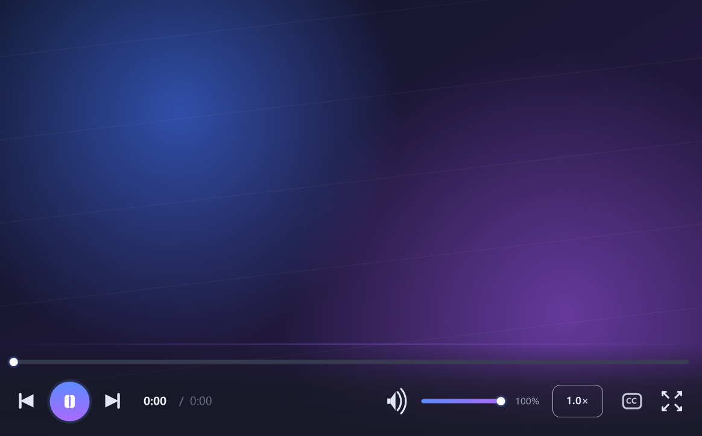
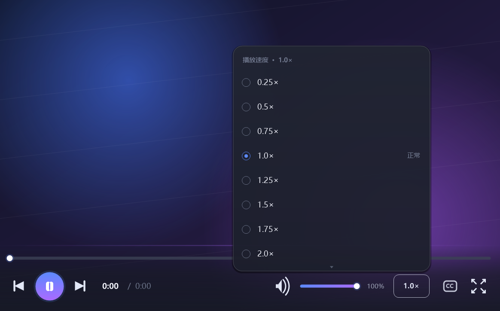
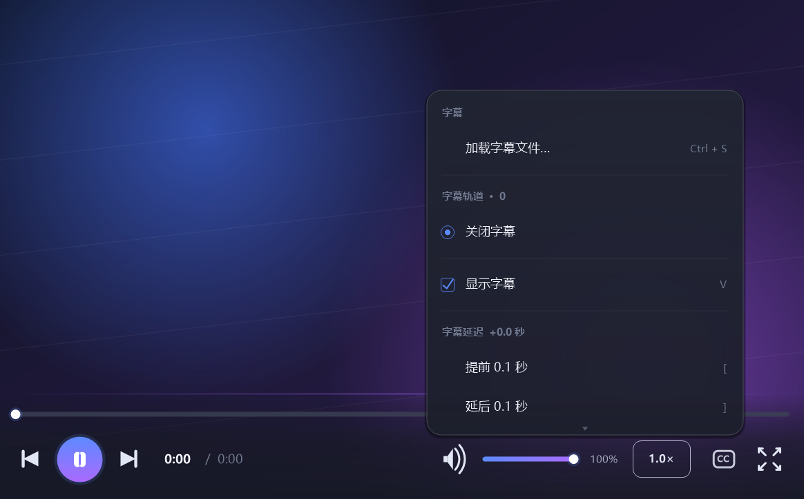
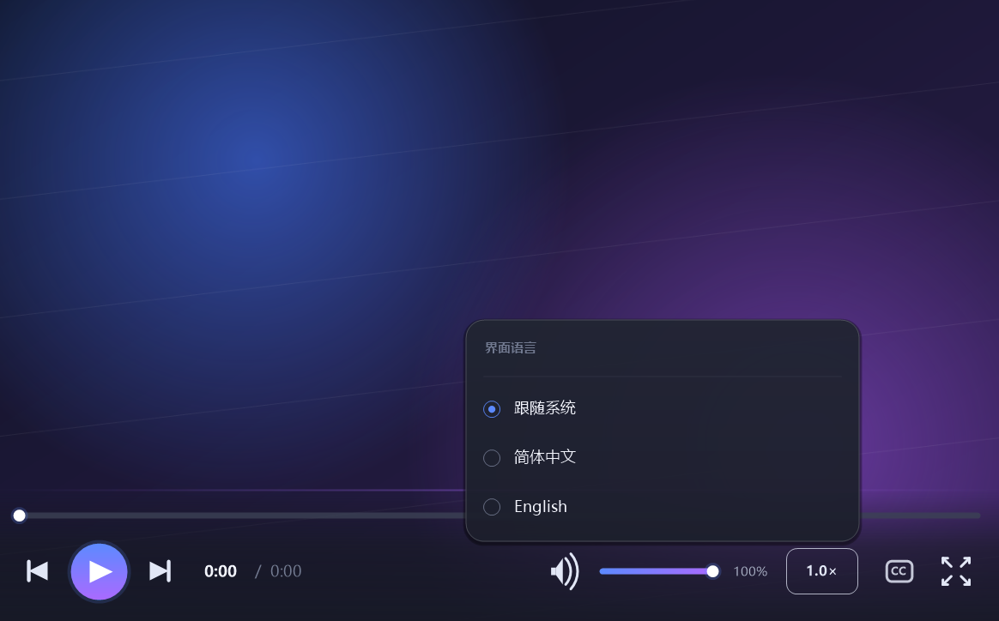

# wmpv

**English** | [简体中文](README.md)

> A Windows media player that just works — one exe, no installer, powered by mpv.

If you just want to sit down and watch something: drop a file into the window and let wmpv take it from there.

wmpv puts the mpv playback engine inside a clean Windows window. The control bar appears when you need it and fades away when you do not; subtitle and speed menus are light, translucent rounded popups; the interface follows your system's light/dark theme and language. There is nothing to install and no codecs or runtimes to download separately.

---

## Getting started

1. Get `wmpv.exe` (64-bit Windows 10/11).
2. Double-click it, then drop a video or audio file into the window — or click **Open File**.
3. Start watching.

> Dropping several files at once builds a playlist that advances automatically.

## What you can do

- **Play common formats directly** — MP4, MKV, AVI, MOV, MP3, FLAC and more, with no converting first.
- **Watch foreign-language content comfortably** — load external subtitles (SRT / ASS / SSA / VTT), switch between embedded and external tracks, show or hide them at any time, and fine-tune the delay by 0.1 s or the font size.
- **Watch at your own pace** — speed presets from 0.25× to 3.0×, plus a one-key reset to normal.
- **Stay comfortable** — fullscreen, seek/volume dragging, mute, wheel volume control, a floating control bar, rounded translucent menus and a theme that follows your system.
- **Use a familiar language** — Simplified Chinese / English, following your system language by default; switch any time and the choice is remembered.

## Screenshots

  
  

  
  

> The picture in the screenshots is a gradient test image used to demonstrate the UI, not real footage. The screenshots show the Chinese interface; English is supported as well.

## Everyday shortcuts

| Key | Action |
| --- | --- |
| `Space` | Play / pause |
| `←` / `→` | Seek −5 / +5 seconds |
| `↑` / `↓` | Volume +5 / −5 |
| `O` | Open file |
| `Ctrl + S` | Load a subtitle file |
| `B` / `P` / `L` | Subtitle / speed / language menu |
| `V` | Show / hide subtitles |
| `M` | Toggle mute |
| `F` | Fullscreen |
| `Esc` | Exit fullscreen / close a menu |
| Mouse wheel | Adjust volume |

For the full shortcut list, command-line options, language overrides and building from source, see the [advanced guide](docs/ADVANCED.en.md).

## License

wmpv is licensed under **GPL-2.0-or-later** ([full text](LICENSE)). If you redistribute it, please read the distribution obligations and third-party licenses in the [advanced guide](docs/ADVANCED.en.md).

---

Further reading: [Advanced guide (English)](docs/ADVANCED.en.md) · [高级使用说明（中文）](docs/ADVANCED.md) · [中文 README](README.md)

## Acknowledgements

[mpv](https://mpv.io/) · [FFmpeg](https://ffmpeg.org/) · [libass](https://github.com/libass/libass) · [libplacebo](https://github.com/haasn/libplacebo) and all upstream contributors.
