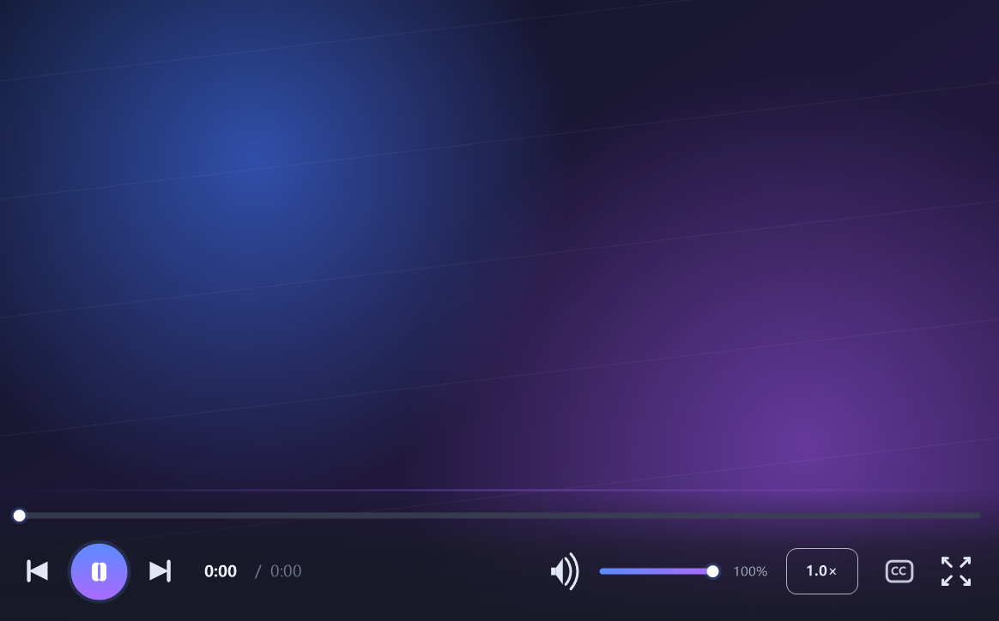
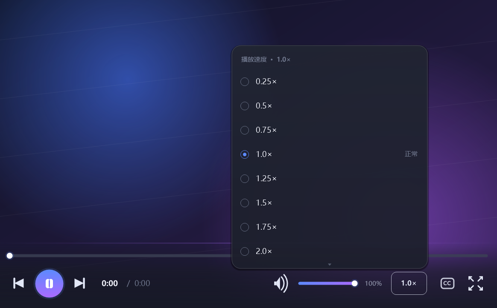
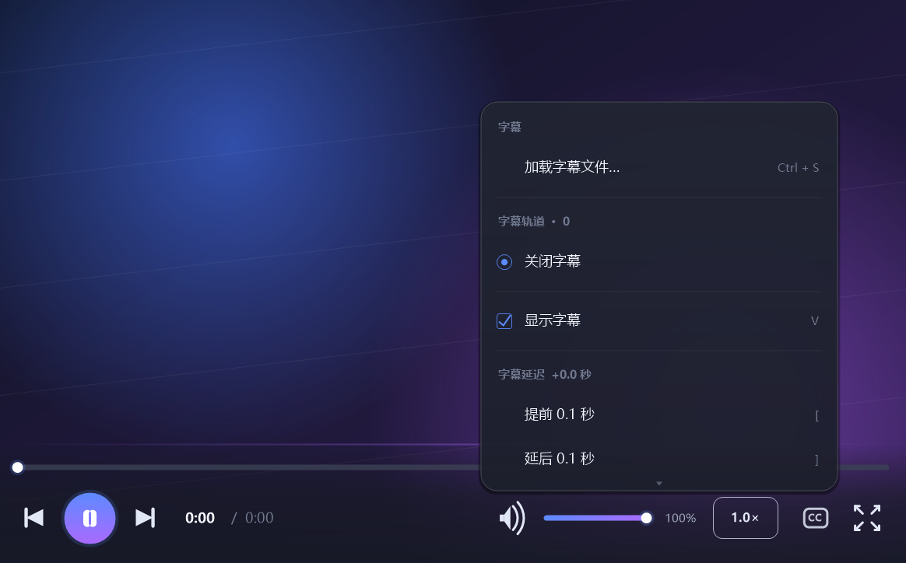
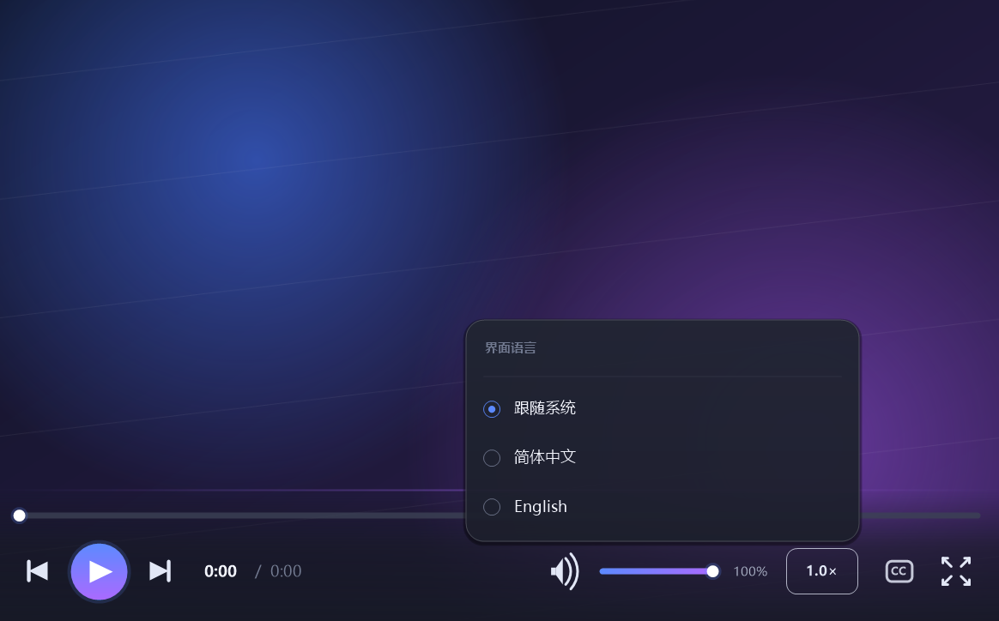

# wmpv

[English](README.en.md) | **简体中文**

> 一个打开就能用的 Windows 播放器 —— 单个 exe、免安装，播放能力来自 mpv。

如果你只是想安安静静看个视频：把文件拖进窗口，剩下的交给它。

wmpv 把 mpv 的播放能力装进一个干净的 Windows 窗口里。控制栏在需要时出现、看完自动隐去；字幕和倍速菜单是轻巧的半透明圆角浮层；界面跟随系统的深浅色与语言。它不需要安装，也不用额外下载解码器或运行库。

---

## 开始使用

1. 拿到 `wmpv.exe`（64 位 Windows 10/11）。
2. 双击运行，把视频或音频文件拖进窗口，或点击界面上的「打开文件」。
3. 开始观看。

> 一次拖入多个文件会自动排成播放列表，播完一个接着下一个。

## 你能做什么

- **常见格式直接播** — MP4、MKV、AVI、MOV、MP3、FLAC 等，不用先转码。
- **看外语片更省心** — 加载外挂字幕（SRT / ASS / SSA / VTT）、切换内嵌或外挂轨道、随时显示或隐藏，还能微调 0.1 秒延迟和字号。
- **按自己的节奏看** — 0.25× ~ 3.0× 倍速预设，也能一键恢复正常速度。
- **看得舒服** — 全屏、进度与音量拖拽、静音、滚轮调音量；悬浮控制栏、圆角半透明菜单、深浅主题跟随系统。
- **用熟悉的语言** — 简体中文 / English，默认跟随系统语言，随时切换并自动记住。

## 界面

  
  

  
  

> 截图中的画面是用于演示界面的渐变图，并非真实影片；截图展示的是中文界面，程序同样支持英文。

## 常用操作

| 按键 | 作用 |
| --- | --- |
| `Space` | 播放 / 暂停 |
| `←` / `→` | 快退 / 快进 5 秒 |
| `↑` / `↓` | 音量 +5 / −5 |
| `O` | 打开文件 |
| `Ctrl + S` | 加载字幕文件 |
| `B` / `P` / `L` | 字幕 / 倍速 / 语言菜单 |
| `V` | 显示 / 隐藏字幕 |
| `M` | 静音 |
| `F` | 全屏 |
| `Esc` | 退出全屏 / 关闭菜单 |
| 滚轮 | 调节音量 |

完整快捷键、命令行参数、语言覆盖与源码构建方法见[高级使用说明](docs/ADVANCED.md)。

## 许可

wmpv 采用 **GPL-2.0-or-later** 开源许可（[全文](LICENSE)）。若要重新分发，请先阅读[高级使用说明](docs/ADVANCED.md)中的分发义务与第三方组件许可。

---

进阶阅读：[高级使用说明（中文）](docs/ADVANCED.md) · [Advanced guide (English)](docs/ADVANCED.en.md) · [English README](README.en.md)

## 致谢

[mpv](https://mpv.io/) · [FFmpeg](https://ffmpeg.org/) · [libass](https://github.com/libass/libass) · [libplacebo](https://github.com/haasn/libplacebo) 以及所有上游贡献者。
